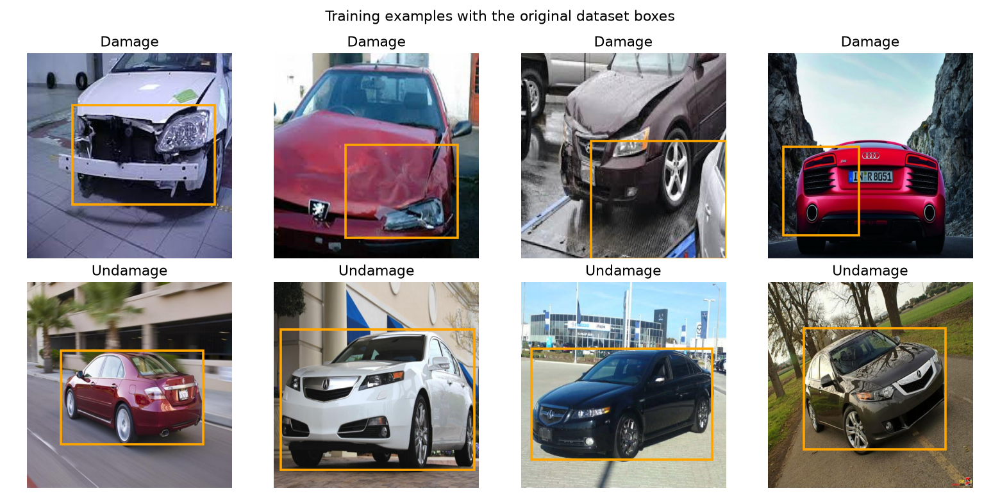
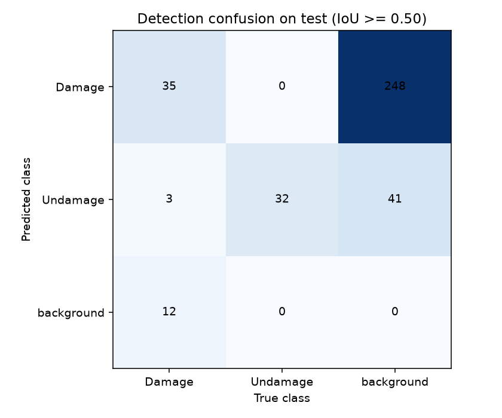
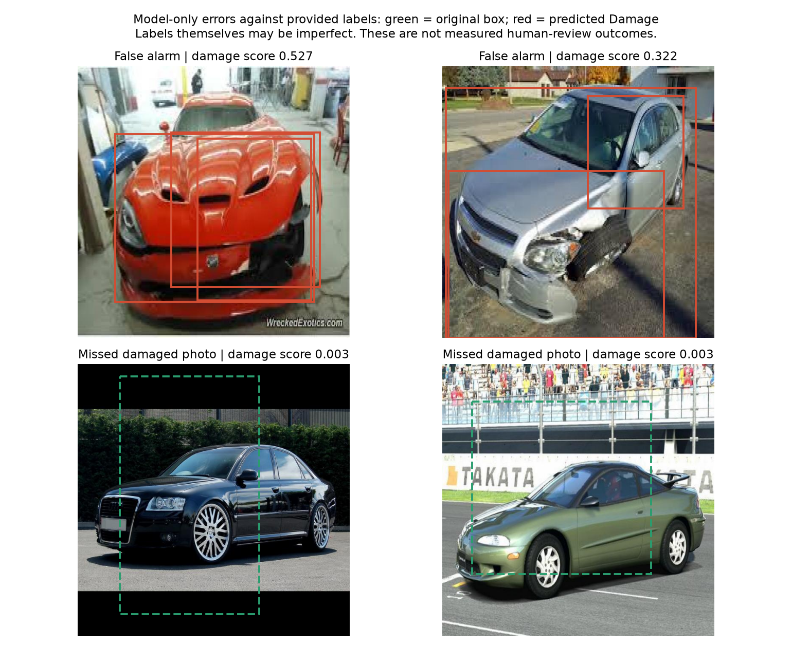
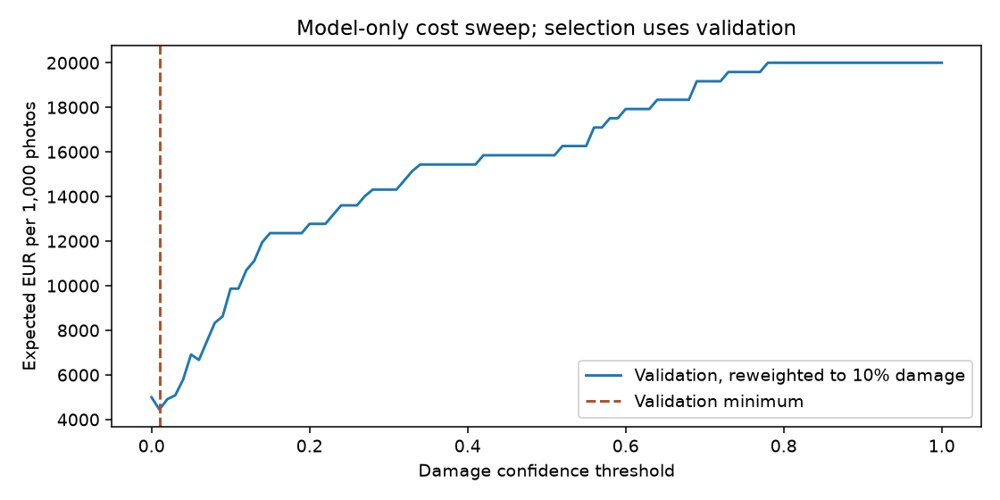

# Rental-car photo damage triage — Assignment 2

The tables below come from actual training and evaluation runs. AI contributions
to the analysis and recommendation are described in the disclosure section.

- **Name:** Javier Corredera
- **Student ID:** 19654
- **Email:** jcorredera.ieu2022@student.ie.edu
- **Group:** BBADBA 5B
- **Date:** 27 October 2026

## Business problem, and the cost of being wrong

The decision is which rental-return vehicle photos should trigger a closer
inspection by staff. Javier chose rental cars and identified missing real
damage as the more expensive mistake. He accepted a starting scenario of
EUR 5 for an unnecessary inspection and EUR 200 additional expected loss for
missed damage, a 40:1 ratio. A correct damage referral also costs EUR 5.

This is inspection support. A photo does not establish whether damage is new,
who caused it, whether the vehicle is safe, or what a customer should pay.
One case is **one photo**. Daily calculations use one selected photo per return
as a planning proxy; the dataset does not validate complete vehicle returns.

This framing was recorded before the dataset search. After the first results,
Javier asked to test a change and improve using evidence. He accepted the
recommendation to retain an offline prototype; normal staff inspections stay in place until
representative rental-return data and labels have been audited.

## Dataset

- **Workspace:** `celebal-wlpui`
- **Project:** `car-damage-zxcdc`
- **Version:** `1`
- **Source:** [Original public Roboflow version](https://universe.roboflow.com/celebal-wlpui/car-damage-zxcdc/dataset/1)
- **Original classes:** `Damage`, `Undamage`.
- **Licence listed by the source API:** Public Domain.

The original labels and splits were used as published. No dataset fork,
relabelling or added images were used. The version applies auto-orientation
and a 640×640 stretch, with no exported augmentation. Model input resizing
and training augmentation are separate from changing the published dataset.

## What the dataset's composition implies

Counts computed from the exported labels **before the first training run**:

| Split | Images | Damage boxes | Undamage boxes | No boxes |
| --- | --- | --- | --- | --- |
| Train | 250 | 135 | 107 | 8 |
| Valid | 84 | 47 | 34 | 3 |
| Test | 84 | 50 | 32 | 2 |

The export has 405 boxes and 13 images without boxes. Images without a Damage
annotation count as operational negatives, including those empty-label images;
this follows the supplied labels and does not prove they are damage-free.
The test set contains 50 Damage photos and 34 without a Damage annotation.
Only 84 test images makes error-rate estimates unstable.

Median box area is approximately 29% of a training image for Damage and 47%
for Undamage. Clean-car boxes often cover much of the car; Damage boxes may
cover a smaller affected region. These are not equally easy detection tasks.
No exact file or decoded-pixel duplicates were found across splits. This does
not rule out similar views, the same vehicles, or other leakage.

The visual audit contains major crash scenes, stock-style clean-car photos,
and questionable labels or box placement. It is a prototype dataset rather
than evidence about subtle scratches in routine rental-return photos.

## Finetuning and baselines

YOLO11n was finetuned from COCO weights on this Apple Silicon laptop using CPU.
Two runs changed only input size: 320 versus 480 pixels. Both used a maximum
of 40 epochs, batch 16, AdamW at initial learning rate 0.001, seed 19654,
patience 12, horizontal flips and no mosaic. Other Ultralytics augmentation
settings stayed at their locked-version defaults.

Within each run, the checkpoint with highest validation mAP50–95 was retained.
Between runs, the selection criterion was **lowest validation triage cost**
under the same business assumptions. The selected input size is
**480 pixels**. A larger input was tested, rather than
assumed to improve the business decision. The validation cost improvement
was only about EUR 29 per 1,000 photos; this small difference is not proof of
a reliable production advantage.

| Image size | Epochs completed | Best validation AP50 | Best validation mAP50–95 | Minimum validation triage cost / 1,000 |
| --- | --- | --- | --- | --- |
| 320 | 32 | 0.583 | 0.407 | EUR 3,533 |
| 480 | 40 | 0.582 | 0.423 | EUR 3,504 |

Final comparisons use the same 84-image test split:

| Model | Test AP50 | Test mAP50–95 |
| --- | --- | --- |
| Finetuned YOLO11n | 0.632 | 0.470 |
| COCO YOLO11n zero-shot | 0.000 | 0.000 |
| Predict no detections | 0.000 | 0.000 |

COCO has neither Damage nor Undamage. The unchanged COCO model was actually
run, but none of its labels can be mapped honestly to these target classes.
A car detection does not mean an undamaged car. Its zero AP reflects this
vocabulary limitation; beating it is weaker evidence than beating a strong
condition-detection baseline. The trivial baseline predicts no boxes.

**Development limitation:** the initial 320-pixel test results were inspected
before deciding to try 480 pixels. Final model and threshold selection use
validation, but the test set is not a completely blind final assessment.

## Per-class evaluation and failure modes

**Damage is the positive class** for the business decision. The operational
score is the highest Damage detection confidence in a photo, or zero when no
such detection is returned. A confidence score is not a calibrated probability.

| Class | Test precision | Test recall | Test AP50 | Test mAP50–95 |
| --- | --- | --- | --- | --- |
| Damage | 0.131 | 0.740 | 0.419 | 0.185 |
| Undamage | 0.421 | 1.000 | 0.846 | 0.756 |

Precision and recall above use the validation-selected model-only threshold
**0.01**, with class-aware IoU ≥ 0.50 matching. AP50 and mAP50–95
summarise detection performance across confidence levels. These are not
classification accuracy scores. An incorrectly located Damage box can fail
the detection metric even if the photo is flagged for inspection.

The per-class table should be used to explain which class carries the average,
rather than presenting the overall AP as evidence that minor damage is solved.
Failure examples are errors against the supplied labels, which can themselves
be imperfect. In two inspected high-confidence false alarms, visibly damaged
cars have empty label files. Other apparent misses show apparently clean cars
with Damage labels. This is evidence that the supplied labels are an unreliable
proxy for physical condition in some cases, rather than proof that every
counted model error is a real inspection mistake. The human reviewer was not
evaluated on these images.

## Cost matrix and operating point

The following are **scenario assumptions**, not measured company losses:

| Final action / actual condition | No relevant Damage label | Damage label |
| --- | ---: | ---: |
| Pass | EUR 0 (TN) | EUR 200 additional missed loss (FN) |
| Hold for closer inspection | EUR 5 (FP) | EUR 5 (TP) |

A human photo review adds EUR 2.50: 5 minutes at EUR 30/hour. Reviewed photos
also incur expected follow-up inspection or missed-loss cost. Initial reviewer
sensitivity and specificity are each assumed to be 95%; held cases are assumed
to receive effective follow-up. Neither human assumption was measured.

[Europcar Spain's published damage matrix](https://www.europcar.es/es-es/p/assets/1bB3O5WAkmeBkwmD2bNDRs),
valid from 10 December 2025, lists example front-door 2–5 cm scratches around
EUR 147–159 and dents around EUR 257–270. These are tariff examples, not the
company's incremental loss. EUR 200 is an assumed additional expected loss
informed by that scale, not a quoted repair average. Common repair expenditure
is outside this comparison rather than treated as avoidable when detected.

[Eurostat's labour-cost data](https://ec.europa.eu/eurostat/databrowser/view/tps00173/default/table?lang=en)
puts Spain's 2025 broad total employer cost at EUR 26.4/hour. EUR 30/hour rounds
above that benchmark; it is not a measured rental-inspector rate. EUR 5 also
corresponds to a 10-minute closer inspection at this assumed rate.

Production prevalence is assumed to be **10%**, versus approximately
59.5% Damage photos in the test data. Costs use
conditional error rates, reweighted to 10%, rather than treating dataset
prevalence as the branch's damage rate. This adjustment does not correct
different lighting, damage severity or annotation quality.

The model-only confidence threshold was swept from 0 to 1 in steps of 0.01.
The validation minimum is **0.01**. Ordered threshold pairs were
also swept on validation. The cost-minimum pair is
**0.00 / 0.06**. Test results did not set those thresholds.

The validation cost minimum is on the boundary: the lower threshold is zero, so it disables automatic passes. Every photo receives human photo review or is held for closer inspection. This is a finding, rather than a reason to invent a third nonempty bucket.

An additional validation-selected policy is constrained to use all three
outcomes on validation: **0.01 / 0.06**.
Its expected test cost is EUR 4,444 per 1,000 photos.
The dashboard makes that option available so the cost of automatic passes is
visible rather than hidden.

## What a person still has to check

Observed test routing at the saved cost-minimum pair:

| Original photo label | Pass | Human review | Fail / hold |
| --- | --- | --- | --- |
| No Damage annotation | 0 | 32 | 2 |
| Damage annotation | 0 | 13 | 37 |

After reweighting to the 10% production scenario, **87.3%**
of photos are sent for review. At 100 selected photos per day, that is
**87.3 reviews**, **437 review
minutes**, or **1.21 staff equivalents** at 360 productive
minutes per person/day. Expected closer-inspection referrals add
194 minutes/day, making
**1.75 total staff equivalents**. Whole-person
staffing, peak periods and whether the same people do both jobs still need
planning. These are photo-screening estimates, not validated whole-car workloads.

| Approach | Expected EUR / 1,000 photos |
| --- | --- |
| Do nothing (pass every photo) | 20,000 |
| Human review of every photo | 4,200 |
| Closer inspection of every return | 5,000 |
| Model alone | 4,679 |
| Model with human review | 3,413 |

All approaches use the same assumed base rate and costs. "Model alone" means
no human *photo review*; flagged cases still receive the priced closer inspection.
"Human review of every photo" uses the same assumed reviewer accuracy, not a
claim that people are perfect. "Closer inspection of every return" assumes
all held cases receive effective follow-up.

The sensitivity files vary missed-loss cost, production prevalence and human
accuracy. For example, with the chosen model and fixed thresholds:

| Assumed human sensitivity and specificity | Review every photo | Frozen hybrid policy |
| --- | --- | --- |
| 90% | EUR 5,400 | EUR 3,878 |
| 95% | EUR 4,200 | EUR 3,413 |
| 99% | EUR 3,240 | EUR 3,040 |
| 100% | EUR 3,000 | EUR 2,947 |

This is why expected savings must be treated as conditional on assumptions,
not as achieved business savings or proof of reduced headcount. Label errors
also weaken the cost estimates themselves: a false alarm against an empty
annotation may actually be a correct real-world damage flag. These calculations
do not establish that the hybrid system would save money in a rental branch.

## Limitations & next steps

- The dataset has few test negatives, some empty labels, crash-heavy imagery
  and uncertain label quality. More epochs or pixels cannot repair those issues.
- The initial test was inspected during development; a fresh final holdout is needed.
- There are no before/after rental pairs, complete return-photo packets,
  vehicle IDs, repair bills, actual staff timings or measured reviewer accuracy.
- Before a live pilot, collect representative return photos including minor
  damage, ordinary clean cars and difficult lighting. Audit labels, split by
  vehicle/return, time the human workflow and measure actual unrecovered losses.
  Compare the proposed policy with existing inspections before allowing any
  automatic vehicle release or customer billing.

